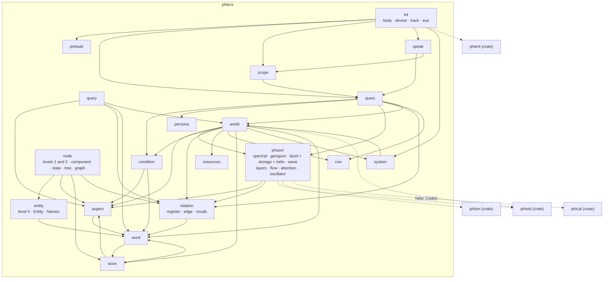
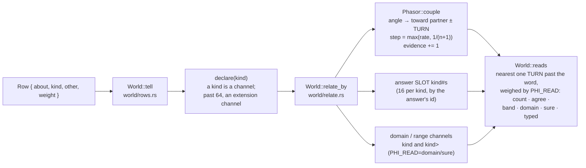

# phiecs — architecture

## The modules and what they use

## How a told row moves the world, and how it is read

## Modules, one diagram each

- [aspect](../../docs/phiecs/aspect.md)
- [condition](../../docs/phiecs/condition.md)
- [entity · node](../../docs/phiecs/node.md)
- [kit](../../docs/phiecs/kit.md)
- [kit · eye](../../docs/phiecs/eye.md)
- [persona](../../docs/phiecs/persona.md)
- [phasor](../../docs/phiecs/phasor.md)
- [phasor · facet](../../docs/phiecs/facet.md)
- [phasor · relational](../../docs/phiecs/relational.md)
- [phasor · wave](../../docs/phiecs/wave.md)
- [phasor · facet · storage](../../docs/phiecs/storage.md) · [helix](../../docs/phiecs/helix.md)
- [phasor · layers](../../docs/phiecs/layers.md) · [flow](../../docs/phiecs/flow.md) · [attention](../../docs/phiecs/attention.md) · [oscillator](../../docs/phiecs/oscillator.md)
- [prelude](../../docs/phiecs/prelude.md)
- [query](../../docs/phiecs/query.md)
- [quest](../../docs/phiecs/quest.md)
- [relation](../../docs/phiecs/relation.md)
- [resources](../../docs/phiecs/resources.md)
- [row](../../docs/phiecs/row.md)
- [scope](../../docs/phiecs/scope.md)
- [speak](../../docs/phiecs/speak.md)
- [store](../../docs/phiecs/store.md)
- [system](../../docs/phiecs/system.md)
- [word](../../docs/phiecs/word.md)
- [world](../../docs/phiecs/world.md)

Notes and tables: [docs/notes.md](../../docs/phiecs/notes.md) · What is left to do: [TODO.md](TODO.md)
